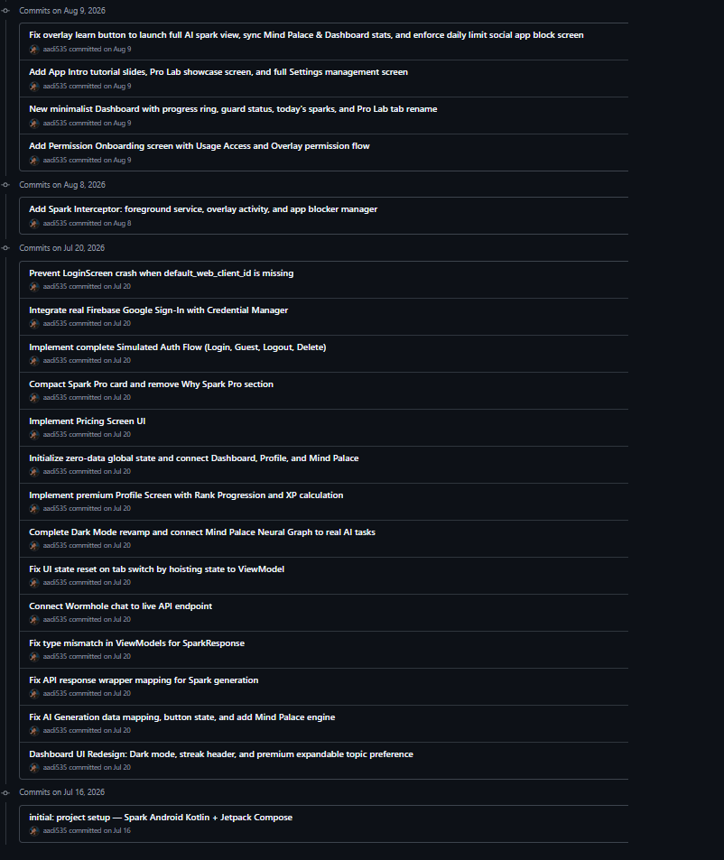
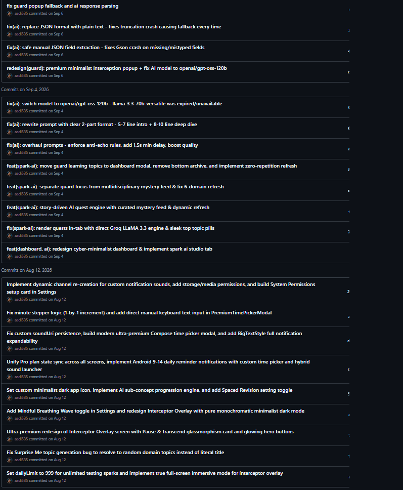
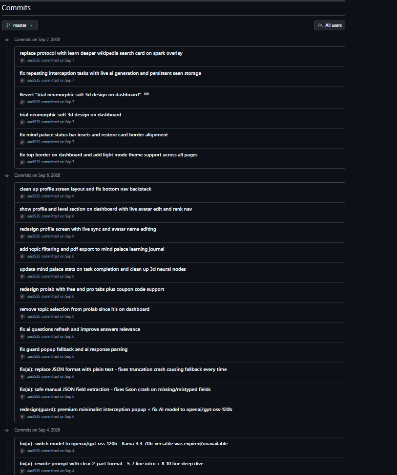
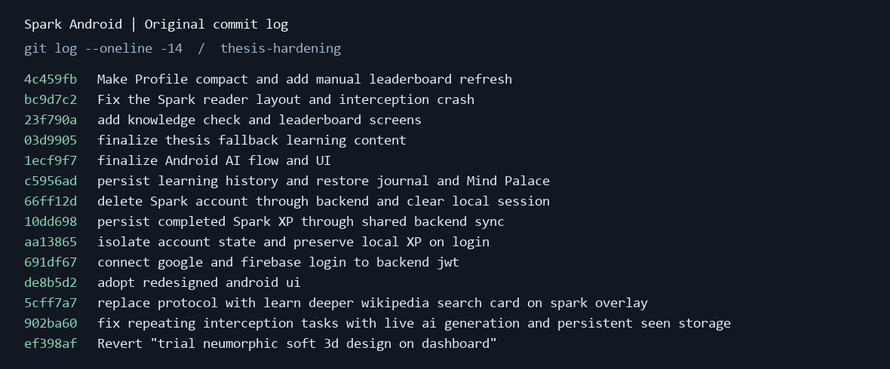

# Development history

These entries come from the original private Spark android repository. The original repository remains private because older revisions contain credentials and development configuration that should stay out of the public review copy. These screenshots from GitHub show the development chronology and contributor account. The right edge has been covered to hide private commit references. Earlier entries document experiments during development.

## GitHub screenshots

### Initial setup

Initial Android setup, Google sign-in, onboarding and the first interception service.



### Focus and ai

Work on the focus overlay, reminders and the Spark AI screen.



### Profile and journal

Profile and journal updates, theme improvements and refinements to the interruption experience.



## Snapshot commit log



```text
4c459fb Make Profile compact and add manual leaderboard refresh
bc9d7c2 Fix the Spark reader layout and interception crash
23f790a add knowledge check and leaderboard screens
03d9905 finalize thesis fallback learning content
1ecf9f7 finalize Android AI flow and UI
c5956ad persist learning history and restore journal and Mind Palace
66ff12d delete Spark account through backend and clear local session
10dd698 persist completed Spark XP through shared backend sync
aa13865 isolate account state and preserve local XP on login
691df67 connect google and firebase login to backend jwt
de8b5d2 adopt redesigned android ui
5cff7a7 replace protocol with learn deeper wikipedia search card on spark overlay
902ba60 fix repeating interception tasks with live ai generation and persistent seen storage
ef398af Revert "trial neumorphic soft 3d design on dashboard"
```
